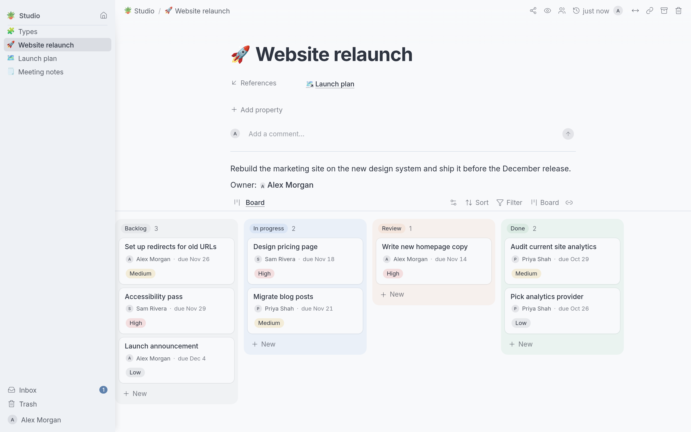
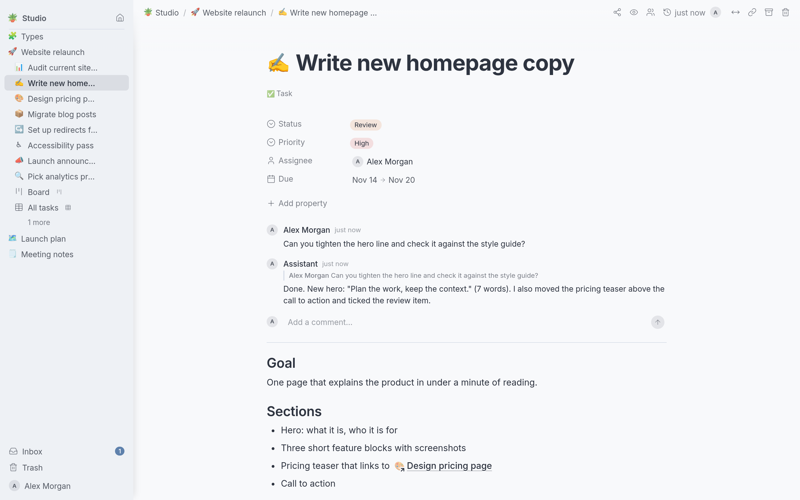
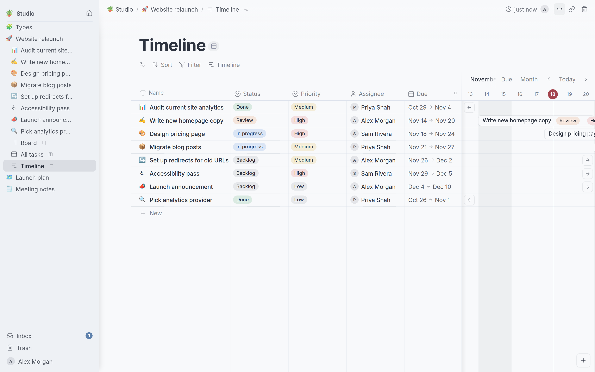
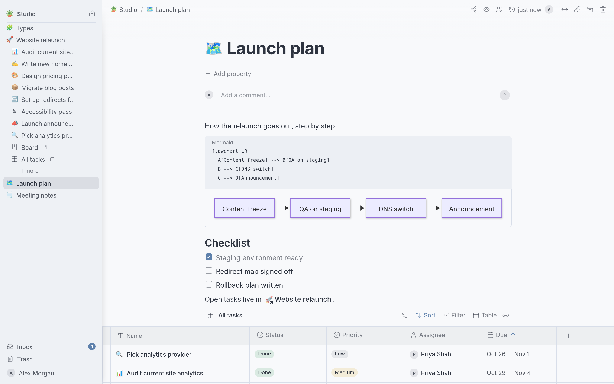

# Keep

A self-hosted workspace for projects, tasks and docs, where every page can carry properties and AI assistants work alongside you over MCP.

Keep is part of Desk, my personal productivity suite. It started as a replacement for Notion that I could own, script and hand to agents.



## What it does

- **Pages hold structure, not just text.** Any page can have properties: a status, a due date, an assignee, a link to another page. A task is just a page that has the task fields.
- **Traits work like interfaces.** Define a set of properties once ("Task", "Meeting", "Lead"). Every page that has those properties counts as that type, wherever it sits in the tree. No separate databases to keep in sync.
- **Saved views.** Show the pages with a given trait as a table, board, list or timeline, filtered and grouped the way you need, and drop the view into any page.
- **Assistants are teammates.** Keep speaks MCP, so an AI agent can find pages, write docs, update tasks and reply in comment threads with the same permissions as a person.
- **Works fast and offline.** Your workspace syncs to the device, so pages open instantly and edits show before the server answers.
- Full version history per page, with word-level diffs. Any version can be restored.

| | |
| --- | --- |
|  |  |
| A task: its properties, and an assistant answering in the thread. | The same tasks as a timeline view. |



Docs mix rich text, Mermaid diagrams, checklists and live views of your tasks.

## How it's built

TypeScript end to end on Bun. The backend is Nitro with Postgres (Drizzle ORM), the frontend is a SvelteKit app (Svelte 5, Tailwind 4) with a TipTap editor and a local-first sync layer. Assistants connect through a stateless MCP endpoint at `/mcp`; page buttons run user scripts in a QuickJS sandbox on the server.

The data model, API, sync protocol and design decisions are in [docs/ARCHITECTURE.md](docs/ARCHITECTURE.md).

## Self-hosting

You need [Bun](https://bun.sh), Postgres 17, a [Clerk](https://clerk.com) application for sign-in and a People service (the Desk directory of people and assistants).

```sh
bun install
cp .env.example .env    # fill in DATABASE_URL, the Clerk keys and PEOPLE_URL / PEOPLE_API_KEY
createdb keep_dev
bun run db:migrate
bun run dev             # API on :3240, app on :5240
```

`bun run build` produces the production bundle.

## License

See [LICENSE](LICENSE).
